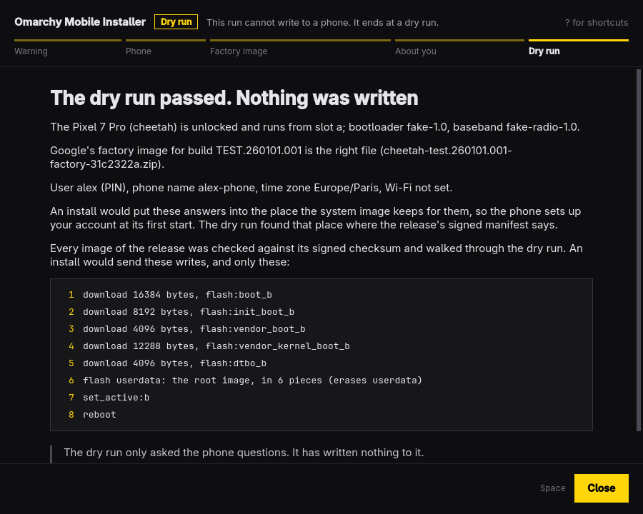

# omainstall



The desktop window of the [Omarchy Mobile installer](../README.md): it guides a person through installing Omarchy Mobile on a phone plugged into this computer. It is built the way Omarchy's own apps are: C++ and Qt Quick, one window, one job, driven from the keyboard, following the desktop's theme.

**It has never been run against a real phone.** Started as it is, it goes through the steps of an install up to the dry run, which lists what an install would write, and ends there: such a window cannot write to a phone. Started with `--write` it goes on: it lists what it will write and what is erased, waits for the phone's codename to be typed, and writes. That path has run against a pretend phone only, and on a Pixel 7 Pro, the one phone it is for, the window reaches it as a reinstall only (the phone runs from slot B; the window asks what slot B holds) and stops a first install before it: [docs/STATUS.md](docs/STATUS.md) says what works, what has never run, what is left out on purpose, and how the app's first attended run goes. [docs/screens/](docs/screens/) has a picture of each screen of a pretend install.

Started with `--write`, after the write it goes on as `tools/install-guided` does: the USB connection to the phone (a NetworkManager connection, shown and added on your click), the phone's first start, the backup of its radio partitions into a folder it names, Google's firmware from the factory image (the release's `tools/phone-provision`), a restart and a check. It runs the release's own tools, after checking each against the release's signed list, and remembers how far it got, so a window closed halfway offers to go on when it is opened again ([docs/DESIGN.md](../docs/DESIGN.md) §13). This computer's SSH public key goes to the phone with your answers, and the phone's first start sets it up for root and your account, so those steps can reach it. The whole run has met stand-ins only, and needs a release built with places for the answers, which none published yet is ([docs/STATUS.md](docs/STATUS.md)).

It is a front end and nothing more. The installer's core (Rust, `../core`) decides the order of the steps, every refusal and every sentence about the phone; the window draws what the core says and hands in what the person did. The two talk through the command-line tool, `omamobile-install`, which the app starts and exchanges JSON lines with. That protocol and the rest of the design are in [docs/APP.md](../docs/APP.md).

The tool's side of that protocol is `omamobile-install json` (`../cli/src/json.rs`). The app's tests drive it with the tool's pretend phone, and a stand-in in `tests/` that replays screens recorded from the core. **The app has not been run with a phone connected to it.**

## Install it (Arch Linux, Omarchy)

The package holds the window and the tool it drives, `omamobile-install`, both built from this checkout, with the launcher entry and the icon:

```sh
git clone https://github.com/derekross/omamobile-installer
cd omamobile-installer/app/pkgbuild
makepkg -si          # builds both (Rust and Qt), runs the tool's own tests, installs; asks for your password
```

`app/bin/install` does the same. `makepkg -s` installs what it needs to build that is missing (the Rust toolchain, `cargo`, among it); the package then needs, besides Qt, what the steps after the write run: OpenSSH, Python, `unzip`, `android-tools`, `erofs-utils`, `e2fsprogs`, `binutils`, `lz4`, `zstd` and `cpio`. NetworkManager is optional: without it you give this computer the address 172.16.42.2/24 on the phone's USB link yourself.

Then "Omarchy Mobile Installer" is in the launcher, or from a terminal:

```sh
omainstall open DIR                    # a dry run, with a release's directory
omainstall open --write DIR            # an install: ERASES the phone once you type its codename
omainstall check                       # is the tool there, and does it speak this app's protocol
```

To remove it: `sudo pacman -R omainstall`. What it leaves in your home: the radio backup (`~/omamobile-backup/`, keep it), the setup's record (`~/.local/state/omamobile-installer/`), a key it made if you had none (`~/.local/share/omamobile-installer/ssh/`), the factory image's download (`~/.cache/omamobile-installer/`), and the NetworkManager connection `omamobile-phone` (`nmcli connection delete omamobile-phone`).

## Shortcuts

| Key | What it does |
| --- | --- |
| `Space`, `Enter` | The step's main action |
| `Tab` | Move between the buttons and fields |
| `F` | Choose the file you saved |
| `O` | Open the step's page in the browser |
| `C` | Copy the command shown |
| `↑` `↓` `PgUp` `PgDn` | Scroll |
| `Esc` | Cancel a download, or close the shortcuts |
| `?` | Show or hide the shortcuts |
| `Q` | Quit (asks first while a step is running; not while the phone is being written) |

While a field has the focus, letters go to the field. While a button has the focus, `Space` and `Enter` press that button.

## Commands

```sh
omainstall                              # the window (the same as `open`)
omainstall open [--reinstall] [DIR]     # a dry run. --reinstall: slot B already holds Omarchy Mobile; DIR: a release's directory
omainstall open --write [--reinstall] DIR   # an install: ERASES the phone once its codename is typed in the window
omainstall check [--json]               # no display: find the installer's tool, say its version and protocol number
```

`--write` is the one switch that lets a window write, and it is never implied: nothing in the window turns it on, and the header says "Install" or "Dry run" from the first screen. The app passes it on as the tool's own `--write` and has no other way to ask for a write. While the phone is written the window does not close.

`check` exits 0 when the tool is found and speaks this app's protocol, and 1 with the reason on standard error otherwise. It asks nothing of a phone.

The tool is looked for beside the app's binary, then on `PATH`. `OMAINSTALL_TOOL=/path/to/tool` names another one, for tests.

## Build and test

Needs `qt6-base`, `qt6-declarative`, `make` and a C++ compiler (all part of Omarchy), and `python3` for the tests' stand-in. The tests against the real tool also need the Rust toolchain (`cargo`); without it they are skipped, and the run says so.

```sh
bin/build       # build/omainstall
bin/test        # the Qt Test binary, offscreen: no window opens, no phone, no USB
bin/install     # makepkg -fsi: the app and the tool, in the launcher (asks for your password)

bin/screens     # a pretend install walked in the window, one picture for each screen, into docs/screens/

OMAINSTALL_SHOTS=/some/dir bin/test     # also saves a picture of each recorded screen there
OMAINSTALL_TOOL=$PWD/tests/stand-in-tool build/omainstall      # try the window against the stand-in
```

`bin/test` first builds `omamobile-install` with its pretend phone (`cargo build --features fake-phone`), and the tests whose names begin with `theRealTool` run the app against it: the straight path to the dry run with a download from a stand-in for Google's server in the test, eight stops, a locked phone, two phones, a file handed in, and a download cancelled and gone on with; and, in a window started to write, a complete pretend install, one the owner does not go ahead with, the pretend phone unplugged mid-write, a download that breaks off and goes on, and the stop for a phone that tells one bootloader slot. Each of them starts the tool through a small script that adds `--fake-phone`, so no USB device is opened, and ends by reading the pretend phone's record: reads only, except where the test is of the writes, and there exactly the writes of an install. Every other test names the stand-in, or a path that does not exist.

`tests/fixtures/screens/` holds the core's own screens, one JSON file for each state and each kind of stop. `tests/record-screens/run` writes them again from the core as it is now (it needs the Rust toolchain; the tests do not).

## Layout

| Path | What |
| --- | --- |
| `src/backend.{h,cpp}` | Starts the tool, speaks the protocol, hands QML the screen as it was sent |
| `src/Main.qml`, `ScreenView.qml`, `AnswersForm.qml`, … | The window: layout and keys |
| `src/filepicker.h`, `portalfilepicker.{h,cpp}` | The file chooser of xdg-desktop-portal, behind an interface the tests replace |
| `src/theme.{h,cpp}`, `translator.{h,cpp}` | Omarchy's accent, Hyprland's rounding and Omarchy's language, followed live |
| `src/i18n/de.json` | German, as the working example of a translation |
| `src/cli.{h,cpp}` | `omainstall check` |
| `tests/` | The Qt tests (against the stand-in and against the real tool), the stand-in for the tool, the recorded screens and the program that records them |
| `docs/` | `STATUS.md`: what works, what has never run, the first attended run. `screens/`: the pictures `bin/screens` writes |
| `pkgbuild/` | The Arch package (the app and `omamobile-install`), the `.desktop` file and the icon |

## Licence

MIT, as the rest of Omarchy Mobile; see [LICENSE](LICENSE). The theme, the translator and the project's shape follow Omacut, Monologue and Hype (MIT, David Heinemeier Hansson).
