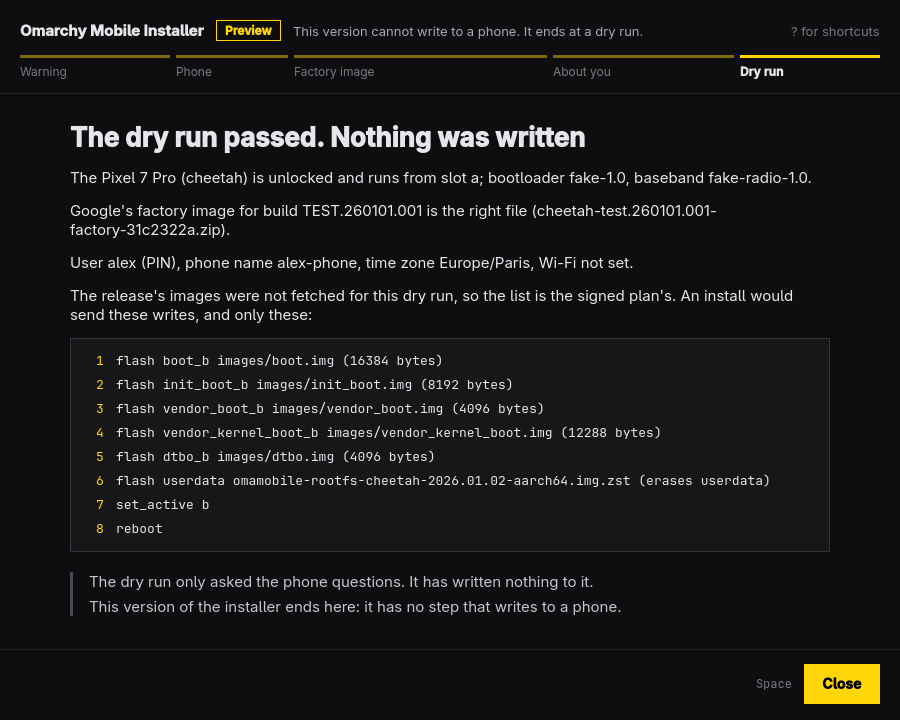

# omainstall



The desktop window of the [Omarchy Mobile installer](../README.md): it guides a person through installing Omarchy Mobile on a phone plugged into this computer. It is built the way Omarchy's own apps are: C++ and Qt Quick, one window, one job, driven from the keyboard, following the desktop's theme.

**This version cannot write to a phone, and it has never been run against one.** It goes through the steps of an install up to the dry run, which lists what an install would write, and ends there.

It is a front end and nothing more. The installer's core (Rust, `../core`) decides the order of the steps, every refusal and every sentence about the phone; the window draws what the core says and hands in what the person did. The two talk through the command-line tool, `omamobile-install`, which the app starts and exchanges JSON lines with. That protocol and the rest of the design are in [docs/APP.md](../docs/APP.md).

**The tool's side of that protocol is not built yet.** Until it is, the app runs only against the stand-in in `tests/`, which replays screens recorded from the core.

## Shortcuts

| Key | What it does |
| --- | --- |
| `Space`, `Enter` | The step's main action |
| `Tab` | Move between the buttons and fields |
| `F` | Choose the file you saved |
| `O` | Open the step's page in the browser |
| `C` | Copy the command shown |
| `↑` `↓` `PgUp` `PgDn` | Scroll |
| `Esc` | Cancel a download, or close the shortcuts |
| `?` | Show or hide the shortcuts |
| `Q` | Quit (asks first while a step is running) |

While a field has the focus, letters go to the field. While a button has the focus, `Space` and `Enter` press that button.

## Commands

```sh
omainstall                              # the window (the same as `open`)
omainstall open [--reinstall] [DIR]     # --reinstall: slot B already holds Omarchy Mobile; DIR: a release's directory
omainstall check [--json]               # no display: find the installer's tool, say its version and protocol number
```

`check` exits 0 when the tool is found and speaks this app's protocol, and 1 with the reason on standard error otherwise. It asks nothing of a phone.

The tool is looked for beside the app's binary, then on `PATH`. `OMAINSTALL_TOOL=/path/to/tool` names another one, for tests.

## Build and test

Needs `qt6-base`, `qt6-declarative`, `make` and a C++ compiler (all part of Omarchy), and `python3` for the tests' stand-in.

```sh
bin/build       # build/omainstall
bin/test        # the Qt Test binary, offscreen: no window opens, no phone, no USB, no Rust build
bin/install     # makepkg -fsi: the app in the launcher (asks for your password)

OMAINSTALL_SHOTS=/some/dir bin/test     # also saves a picture of each screen there
OMAINSTALL_TOOL=$PWD/tests/stand-in-tool build/omainstall      # try the window against the stand-in
```

The tests never start a real `omamobile-install`: every one names the stand-in, or a path that does not exist.

`tests/fixtures/screens/` holds the core's own screens, one JSON file for each state and each kind of stop. `tests/record-screens/run` writes them again from the core as it is now (it needs the Rust toolchain; the tests do not).

## Layout

| Path | What |
| --- | --- |
| `src/backend.{h,cpp}` | Starts the tool, speaks the protocol, hands QML the screen as it was sent |
| `src/Main.qml`, `ScreenView.qml`, `AnswersForm.qml`, … | The window: layout and keys |
| `src/filepicker.h`, `portalfilepicker.{h,cpp}` | The file chooser of xdg-desktop-portal, behind an interface the tests replace |
| `src/theme.{h,cpp}`, `translator.{h,cpp}` | Omarchy's accent, Hyprland's rounding and Omarchy's language, followed live |
| `src/i18n/de.json` | German, as the working example of a translation |
| `src/cli.{h,cpp}` | `omainstall check` |
| `tests/` | The Qt tests, the stand-in for the tool, the recorded screens and the program that records them |
| `pkgbuild/` | The Arch package, the `.desktop` file and the icon |

## Licence

MIT, as the rest of Omarchy Mobile; see [LICENSE](LICENSE). The theme, the translator and the project's shape follow Omacut, Monologue and Hype (MIT, David Heinemeier Hansson).
